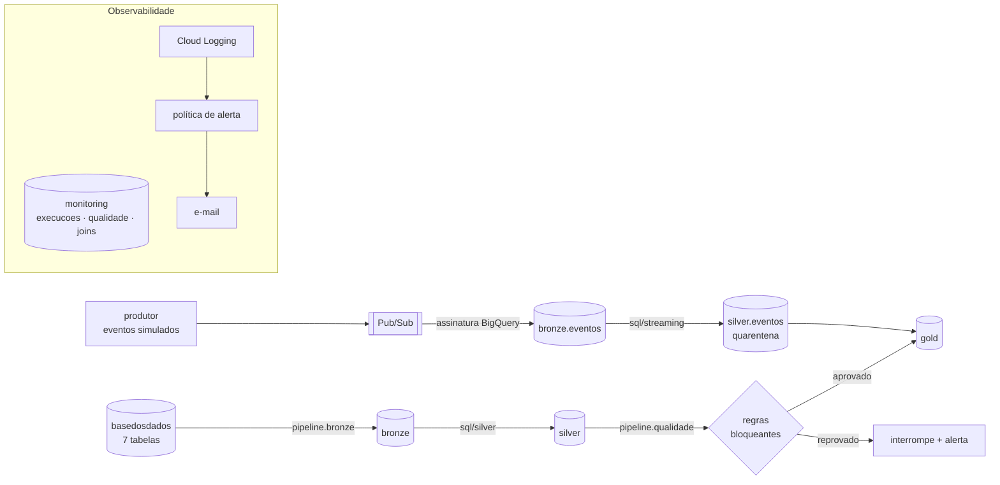

# Tech Challenge Fase 2: Pipeline Híbrido para Análise da Alfabetização no Brasil

Pipeline de dados **batch + streaming** em **Arquitetura Medalhão** (Bronze → Silver → Gold) sobre o Indicador Criança Alfabetizada (Inep / Base dos Dados), executado no Google Cloud (BigQuery, Pub/Sub, Cloud Logging e Cloud Monitoring).

**Vídeo executivo:** _link a incluir_

---

## 1. Contexto

O Compromisso Nacional Criança Alfabetizada tem como objetivo garantir que as crianças estejam alfabetizadas ao fim do 2º ano do ensino fundamental. A partir da Pesquisa Alfabetiza Brasil, o Inep definiu o ponto de corte de **743 pontos** na escala do Saeb. O **Indicador Criança Alfabetizada** é o percentual de estudantes avaliados que atingem esse patamar, ponderado pelo peso amostral.

O pipeline integra metas (Brasil, UF e município), resultados por município e UF e o microdado de alunos para medir a distância de cada território em relação à meta.

**Meta de 2030.** Todas as distâncias usam a **meta pactuada da fonte** (rede Pública = 80%). A universalização (100%) é tratada apenas como cenário aspiracional e não entra em nenhum cálculo.

## 2. Arquitetura



| Camada | Conteúdo |
|---|---|
| **Bronze** | Cópia integral das 7 tabelas da fonte, em **append**, com `_run_id` e `_ingested_at`. Particionada por data de ingestão e clusterizada por `_run_id`. `eventos` recebe as mensagens cruas do Pub/Sub. |
| **Silver** | Tipos corrigidos, `id_municipio` normalizado em 7 dígitos, `rede` decodificada pelo dicionário oficial (código sem tradução vira `desconhecido`), UF e região derivadas do código IBGE, nulos preservados. Agregado do microdado (`alunos_agg`). Eventos válidos deduplicados e quarentena. |
| **Gold** | Meta × resultado por município, UF e Brasil; evolução temporal; validação cruzada; base de features para ML; métricas do streaming; tabela unificada oficial + simulado. |

### Política de escrita da Bronze
A Bronze só recebe `INSERT INTO ... SELECT`; não há `CREATE OR REPLACE`, `TRUNCATE` ou sobrescrita de partição. Cada execução acrescenta uma carga identificada por `_run_id`, e a quantidade de linhas gravadas é conferida contra a fonte. A Silver processa somente a última carga concluída com sucesso. Silver e Gold são derivadas e reconstruídas a cada execução.

### Batch × streaming

| | Batch | Streaming |
|---|---|---|
| Unidade | tabelas completas (3,9 milhões de linhas por carga) | eventos individuais (~290 bytes) |
| Frequência | diária | micro-lotes; o Pub/Sub recebe continuamente |
| Latência | horas | mediana de 0,051 s até o Pub/Sub |
| Garantia | recarga completa, rastreável por `_run_id` | *at-least-once*: deduplicação por `event_id` |
| Dado inválido | interrompe o pipeline | quarentena com `motivo_rejeicao` |

O processamento do streaming é incremental: cada execução lê apenas as mensagens cujo `message_id` ainda não foi registrado em `eventos_processados`. Todo dado do streaming é **simulado** e carrega `origem = 'simulado'`; o dado da fonte carrega `origem = 'oficial'`. A tabela `indicador_unificado_municipio` reúne os dois mantendo-os separáveis.

## 3. Estrutura do repositório

```
tech_challenge_fase_2/
├── pipeline/
│   ├── config.py           configuração (.env)
│   ├── bigquery.py         cliente e execução de SQL
│   ├── monitoramento.py    registro de execuções e notificação de falhas
│   ├── bronze.py           ingestão batch
│   ├── silver.py           camada Silver
│   ├── qualidade.py        regras de qualidade e taxa de correspondência dos joins
│   ├── gold.py             camada Gold
│   ├── orquestrador.py     bronze → silver → qualidade → gold
│   └── streaming/
│       ├── produtor.py     produtor de eventos simulados
│       └── processamento.py processamento incremental
├── sql/
│   ├── silver/             9 transformações
│   ├── gold/               6 tabelas analíticas
│   └── streaming/          6 etapas do micro-lote
├── infra/
│   ├── ambiente.py         datasets, tabelas, tópico, assinatura e permissões
│   └── alerta.py           métrica, canal e política de alerta
├── scripts/
│   ├── demo_falha.py       demonstração de falha controlada
│   ├── reiniciar_streaming.py
│   └── consultar.py
├── requirements.txt
└── .env.example
```

## 4. Tecnologias

| Tecnologia | Uso |
|---|---|
| BigQuery | armazenamento e processamento das três camadas |
| Python 3.11+ (`google-cloud-bigquery`, `google-cloud-pubsub`, `google-cloud-logging`) | ingestão, orquestração, monitoramento |
| SQL (BigQuery) | transformações Silver, Gold e streaming |
| Pub/Sub com assinatura BigQuery | mensageria do streaming |
| Cloud Logging + Cloud Monitoring | alerta de falha por e-mail |

**Não implementado:** agendador (Cloud Scheduler/Workflows), Terraform, CI e testes automatizados.

## 5. Decisões arquiteturais

| Decisão | Escolha | Trade-off |
|---|---|---|
| Acesso à fonte | Consulta direta ao BigQuery público | Sem download nem *egress*; o custo é o volume lido, medido por *dry run*. Uma atualização da fonte entra como nova carga na Bronze na execução seguinte. |
| Nuvem | Somente GCP | Evita *egress* entre nuvens, duplicação de armazenamento e dois modelos de billing e IAM. |
| Lake × warehouse | Warehouse (BigQuery) em todas as camadas | Operação serverless e SQL; armazenamento proprietário e mais caro por GB que Parquet em object storage. |
| Transformações | SQL versionado, executado em ordem pelo Python | Simples de auditar; sem linhagem e testes declarativos de uma ferramenta como dbt. |
| Consumidor do streaming | Assinatura BigQuery do Pub/Sub | Nenhum processo permanente; o instante de ingestão é o `publish_time` do Pub/Sub. |
| Localização | `US` | Mesma location da fonte; o BigQuery não executa joins entre locations. |

## 6. Qualidade de dados

`pipeline/qualidade.py` executa 15 regras e 6 medições de join sobre a Silver. O resultado de cada uma é gravado em `monitoring.qualidade` e `monitoring.joins` (append). Uma regra bloqueante reprovada interrompe o pipeline **antes da Gold**, e o processo termina com código diferente de zero.

| Tipo | Regras |
|---|---|
| Bloqueante | duplicidade de chave (município, UF, alunos, metas); chaves nulas; `id_municipio` com 7 dígitos; município sem UF; rede sem tradução (deve ser zero); taxa fora de (0, 100]; proficiência ou peso ≤ 0; `alfabetizado` coerente com proficiência ≥ 743 |
| Informativa | metas municipais sem taxa (120); metas 2030 ausentes ou ≠ 80 (2); taxa divergente entre tabelas (3) |

| Join | Limiar | Medido | Justificativa do limiar |
|---|---|---|---|
| município → meta municipal | 95% | 97,78% | a fonte não tem meta para ~96 municípios |
| meta municipal → município | 95% | 99,53% | |
| UF → meta UF | 85% | 100,00% | |
| meta UF → UF | 85% | 90,74% | DF, RR e AC ausentes na tabela `uf`: teto de 90,7% |
| alunos → UF | 99,9% | 100,00% | todo código IBGE deve ter UF |
| alunos → município | 95% | 99,92% | |

**Falha demonstrada.** `scripts/demo_falha.py` injeta uma linha duplicada em `bronze.uf`. A regra `duplicidade_uf` reprova, o pipeline é interrompido, a Gold permanece com a data de modificação anterior, o alerta é emitido e a linha é removida em seguida.

## 7. Monitoramento e alertas

- `monitoring.execucoes`: duração, linhas, bytes faturados, status e erro de cada etapa, acumulando execuções.
- `monitoring.qualidade` e `monitoring.joins`: histórico das validações.
- `gold.streaming_metricas`: volume, descartes, eventos atrasados, latências negativas e latência p50/p95, medida como `publish_time − produced_at`.
- Alerta: falhas são registradas como `ERROR` no log `pipeline_alfabetizacao`; a métrica `pipeline_falhas` alimenta uma política do Cloud Monitoring que notifica por e-mail.

**Quem descobre uma falha e em quanto tempo.** O destinatário cadastrado em `ALERTA_EMAIL`. O registro chega ao Cloud Logging no momento da falha e a política avalia janelas de 60 segundos. A ausência de execução não é detectada, porque não há agendador.

## 8. FinOps

Quantidades medidas em `INFORMATION_SCHEMA.JOBS_BY_PROJECT`; preços do Cloud Billing Catalog (USD): BigQuery US$ 6,25/TiB lido (1 TiB/mês gratuito) e US$ 0,02/GiB-mês de armazenamento ativo (10 GiB gratuitos); Pub/Sub US$ 40/TiB de publicação e US$ 50/TiB de entrega ao BigQuery (10 GiB gratuitos).

**Por execução**

| Etapa | Duração | Bytes faturados |
|---|---|---|
| Bronze | 43 s | 387 MiB |
| Silver | 22 s | 516 MiB |
| Qualidade | 33 s | 540 MiB |
| Gold | 12 s | 150 MiB |
| **Batch completo** | **~2 min** | **1.593 MiB (≈ US$ 0,0095)** |
| Micro-lote de streaming | ~17 s | 150 MiB (≈ US$ 0,0009) |

**Projeção mensal** — batch diário e micro-lote a cada 15 minutos com 100 eventos (premissa de 9.600 eventos/dia).

| Serviço | Unidade | Quantidade | Preço unitário | Custo mensal |
|---|---|---|---|---|
| BigQuery — consultas batch | GiB | 46,7 | US$ 6,25/TiB | US$ 0,28 |
| BigQuery — consultas streaming | GiB | 421,9 | US$ 6,25/TiB | US$ 2,57 |
| BigQuery — armazenamento (1º mês) | GiB | 11,5 | US$ 0,02/GiB-mês | US$ 0,23 |
| Pub/Sub (1 KB por mensagem, premissa) | GiB | 0,27 | US$ 90/TiB | US$ 0,02 |
| Cloud Logging / Monitoring | — | volume desprezível | cota gratuita | US$ 0,00 |
| **Total (preço de lista)** | | | | **≈ US$ 3,10** |

Com as cotas gratuitas, o custo de consultas é zero (0,46 TiB de 1 TiB) e o de armazenamento fica em ≈ US$ 0,03.

A cadência do streaming é o principal fator de custo: micro-lotes a cada 5 minutos custariam ≈ US$ 8,01/mês; a cada hora, ≈ US$ 0,93.

Práticas aplicadas: partição e cluster na Bronze; *dry run* antes da ingestão; limite de bytes por consulta; agregação do microdado lida uma única vez (`alunos_agg`); recursos serverless. Ponto de melhoria identificado: a etapa de qualidade relê a tabela de alunos em várias regras (540 MiB por execução).

## 9. Resultados

| Indicador | Valor |
|---|---|
| Linhas ingeridas por carga | 3.902.954 |
| Taxa Brasil, rede pública | 55,9% (2023) · 59,2% (2024) · 66,0% (2025) |
| Municípios frente à meta de 2024 (rede municipal) | 2.788 atingiram (51,2%) · 2.444 não atingiram · 216 sem meta |
| Validação cruzada Brasil | 2024: 59,20 recalculado = 59,2 oficial · 2023: 57,46 recalculado × 55,9 oficial |
| Streaming (210 mensagens) | 188 válidas e únicas · 10 duplicadas · 12 em quarentena · 9 atrasadas |

**Validação cruzada.** A taxa é recalculada a partir do microdado como soma dos pesos dos alunos alfabetizados dividida pela soma dos pesos dos alunos avaliados. A convergência em 2024 confirma tipos, filtros, ponderação e denominador do pipeline. A divergência de 2023 permanece sem causa identificada.

## 10. Aplicação em IA

`gold.features_ml_municipio` contém, para 5.396 municípios, variáveis de 2023 (taxa, proficiência média, participação, alunos registrados e avaliados, meta de 2024, UF e região) e o alvo `alvo_taxa_2024`. A tabela permite modelos de predição da alfabetização municipal, análise de desigualdade entre territórios e priorização de políticas pelos municípios mais distantes da meta.

Para evitar vazamento de alvo, a base não inclui nenhuma variável de 2024 além do alvo, nem colunas derivadas da taxa (nível de alfabetização, status e distância da meta). Dados simulados do streaming não devem ser usados no treino. Com apenas dois anos disponíveis há um único par temporal; projeções até 2030 são cenários, não previsões.

## 11. Como executar

Pré-requisitos: projeto GCP com faturamento ativo, Python 3.11+ e Google Cloud CLI.

```bash
gcloud services enable bigquery.googleapis.com pubsub.googleapis.com logging.googleapis.com \
  monitoring.googleapis.com cloudresourcemanager.googleapis.com
gcloud auth application-default login

python -m venv .venv
source .venv/bin/activate        # Windows: .\.venv\Scripts\Activate.ps1
pip install -r requirements.txt
cp .env.example .env             # preencher GCP_PROJECT e ALERTA_EMAIL

python -m infra.ambiente
python -m infra.alerta

python -m pipeline.orquestrador                 # batch completo
python -m pipeline.streaming.produtor --n 200   # eventos simulados
python -m pipeline.streaming.processamento      # micro-lote
python -m scripts.demo_falha                    # falha controlada
```

Execuções individuais: `python -m pipeline.bronze [--dry-run]`, `python -m pipeline.silver`, `python -m pipeline.qualidade`, `python -m pipeline.gold`.

## 12. Limitações

- Sem agendador: as execuções são disparadas manualmente e a ausência de execução não gera alerta.
- Sem retentativa automática, testes automatizados, CI ou Terraform; a infraestrutura é criada por scripts idempotentes.
- Streaming simulado; a latência é medida até o Pub/Sub. Por depender de dois relógios, diferenças de sincronização entre a máquina produtora e o Google aparecem como latências negativas (40 eventos na execução registrada, com o relógio local ~37 ms à frente). Essas ocorrências são contabilizadas em `latencias_negativas`.
- Sem política de retenção da Bronze (≈ 0,38 GiB por carga).
- Lacunas da fonte: a tabela `uf` e o microdado não cobrem AC (2023), DF e RR; 120 registros de meta municipal sem taxa; resultados por município e UF disponíveis até 2024.
- Três municípios com taxa de 2023 inconsistente entre as tabelas `municipio` e de metas (sinalizados em `inconsistencia_fonte`, não corrigidos).
- A recepção do e-mail de alerta não foi verificada; a chegada do registro ao Cloud Logging foi.
# fiap_fase2
# fiap_fase2
